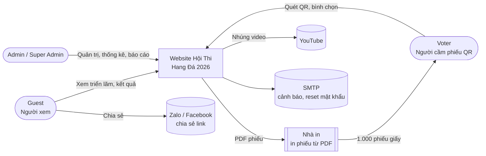
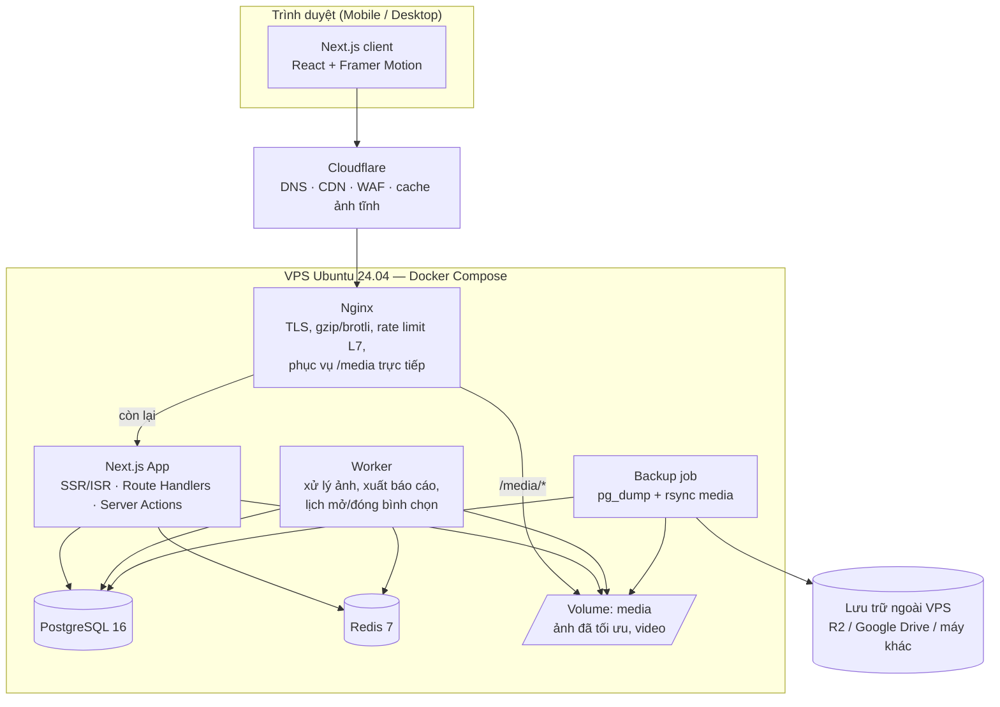
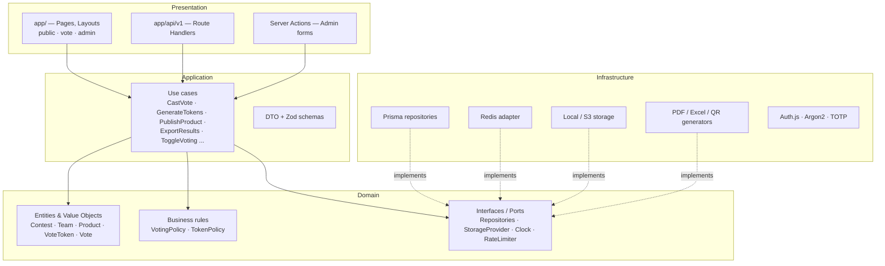
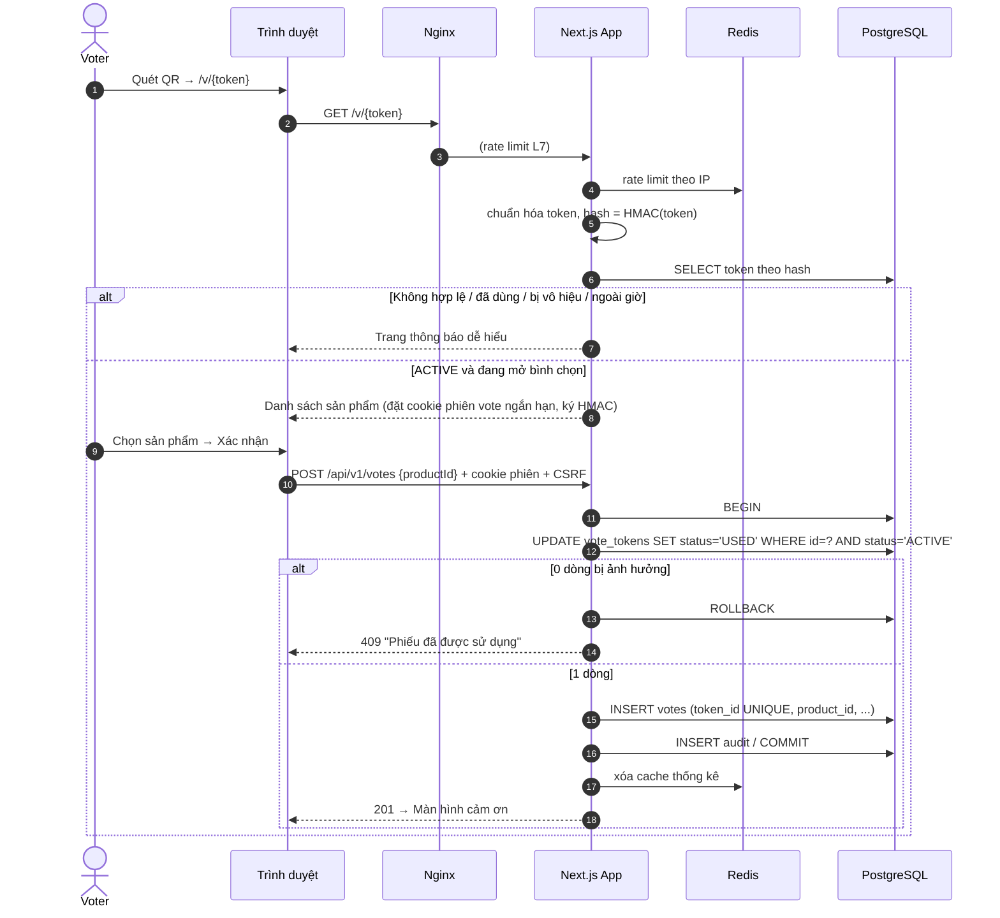
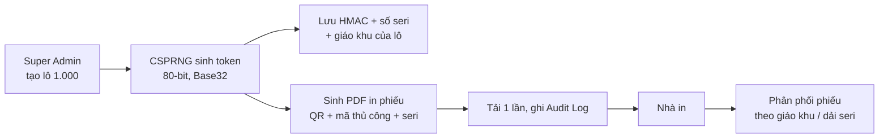

# Kiến trúc hệ thống — Hội Thi Hang Đá Giáng Sinh 2026

| Mục | Nội dung |
|---|---|
| Phiên bản | 0.1 (bản nháp chờ duyệt) |
| Ngày | 2026-10-24 |
| Phạm vi | Tổng quan kiến trúc hệ thống. Chi tiết component, deployment, ERD, permission matrix, security nằm ở Phase 2 đầy đủ |

---

## 1. Nguyên tắc kiến trúc

1. **Đơn giản trước, mở rộng sau**: một ứng dụng Next.js (modular monolith) trên một VPS. Với 13 sản phẩm và ~500–5.000 người dùng, microservices là thừa.
2. **Đọc nhiều, ghi ít**: hơn 99% request là đọc nội dung triển lãm, nên cache mạnh ở CDN và ISR. Ghi duy nhất có tải là bình chọn (tối đa 1.000 phiếu).
3. **Tính đúng của phiếu nằm ở database**: chống trùng bằng transaction + ràng buộc `UNIQUE` của PostgreSQL, không dựa vào cache hay logic phía client.
4. **Clean Architecture**: tách Domain / Application / Infrastructure / Presentation; business logic không phụ thuộc framework.
5. **Đa cuộc thi**: mọi dữ liệu nghiệp vụ gắn với `contest_id`.

## 2. Tech stack

| Lớp | Công nghệ | Lý do |
|---|---|---|
| Framework | **Next.js 15 (App Router) + TypeScript strict** | SSR/SSG/ISR cho SEO + hiệu năng; frontend và backend trong một codebase |
| UI | Tailwind CSS, shadcn/ui (Radix) | Nhanh, accessible, dễ tùy biến theme Gold/Burgundy |
| Animation | Framer Motion, CSS animation, canvas nhẹ cho tuyết | Theo yêu cầu; có cơ chế tắt khi thiết bị yếu |
| Gallery | yet-another-react-lightbox (zoom, slideshow, swipe) | Đủ tính năng xem ảnh lớn, nhẹ |
| Validation | Zod | Dùng chung client/server, sinh kiểu TypeScript |
| ORM | Prisma | Type-safe, migration có quản lý |
| Database | **PostgreSQL 16** | Transaction ACID, ràng buộc unique, đáng tin cho dữ liệu phiếu |
| Cache / Rate limit | **Redis 7** | Rate limit, cache thống kê, khóa ngắn hạn |
| Auth (Admin) | Auth.js v5 (Credentials) + Argon2id + TOTP (otplib) | Chỉ Admin có tài khoản |
| Ảnh | sharp (resize, WebP/AVIF, xóa EXIF) | Tối ưu ảnh lúc upload, không xử lý lúc request |
| Lưu trữ file | Local volume trên VPS, đặt sau interface `StorageProvider` | Đơn giản, rẻ; có thể chuyển sang S3/R2 mà không sửa nghiệp vụ |
| QR / PDF | `qrcode`, `@react-pdf/renderer` | Sinh PDF phiếu in và biên bản kết quả |
| Excel | ExcelJS | Xuất .xlsx |
| Charts | Recharts | Biểu đồ dashboard |
| Test | Vitest, Playwright, k6 | Unit/integration, E2E, load test |
| Hạ tầng | Docker Compose, Nginx, Certbot (Let's Encrypt), Cloudflare (CDN, tùy chọn) | VPS Ubuntu 24.04 |
| Giám sát | Uptime Kuma, Sentry (hoặc GlitchTip tự host), log JSON (pino) | Chi phí thấp, đủ dùng |

## 3. Sơ đồ ngữ cảnh hệ thống (C4 — Level 1)



## 4. Sơ đồ container (C4 — Level 2)



**Ghi chú**

- Ở quy mô này, `Worker` có thể chạy chung process với App (job queue dựa trên PostgreSQL hoặc BullMQ/Redis). Tách container riêng để việc xử lý ảnh nặng không làm chậm request.
- Cloudflare là tùy chọn nhưng nên dùng (gói miễn phí), giúp chịu 5.000 người dùng đồng thời mà không cần nâng cấp VPS.

## 5. Kiến trúc ứng dụng (Clean Architecture)



Quy tắc phụ thuộc: `Presentation → Application → Domain ← Infrastructure`. Domain không import Next.js, Prisma hay Redis.

### Cấu trúc thư mục dự kiến

```
src/
  app/
    (public)/            # trang chủ, trien-lam, ket-qua, tin-tuc
    (vote)/v/[token]/    # luồng bình chọn (bundle nhẹ, không hiệu ứng nặng)
    (vote)/vote/         # nhập mã thủ công
    admin/               # trang quản trị (yêu cầu đăng nhập)
    api/v1/              # REST API
  domain/                # entities, value objects, business rules, ports
  application/           # use cases, DTO, Zod schemas
  infrastructure/        # prisma, redis, storage, pdf, excel, qr, auth
  components/            # UI dùng chung (ui/, exhibition/, effects/, admin/)
  lib/                   # tiện ích thuần
prisma/                  # schema.prisma, migrations, seed.ts
worker/                  # entrypoint worker
tests/                   # unit/, integration/, e2e/, load/
docs/                    # tài liệu dự án
deploy/                  # nginx, docker, scripts backup/restore
```

## 6. Các luồng chính (tóm tắt — chi tiết ở Phase 2)

### 6.1 Luồng bình chọn QR



Token gốc chỉ có trong URL lần đầu. Sau khi xác thực, server đặt cookie phiên ngắn hạn (15 phút) chứa `token_id` đã ký, rồi chuyển hướng sang `/v/s` để token không nằm lại trong lịch sử trình duyệt hay header Referer.

### 6.2 Luồng sinh token và in phiếu



### 6.3 Luồng triển lãm

Trang công khai được render tĩnh (ISR). Khi Admin xuất bản/sửa sản phẩm, hệ thống gọi `revalidatePath`/`revalidateTag` để cập nhật ngay. Ảnh được phục vụ qua Nginx/CDN với `Cache-Control: immutable` (tên file chứa hash).

### 6.4 Luồng kết quả realtime

- `results_public = false` → API công khai trả `403 RESULTS_HIDDEN`, trang hiển thị "Kết quả sẽ được công bố sau".
- `results_realtime = true` → client polling `GET /api/v1/results` mỗi 10 giây. Kết quả được cache trong Redis 5 giây, nên 5.000 client chỉ tạo khoảng 1 truy vấn DB mỗi 5 giây. Chọn polling thay vì WebSocket vì đơn giản và đủ với quy mô này.

## 7. Bảo mật (tổng quan)

| Lớp | Biện pháp |
|---|---|
| Mạng | Cloudflare WAF/DDoS, UFW chỉ mở 22/80/443, SSH chỉ dùng key, fail2ban |
| Truyền tải | TLS 1.2+, HSTS, chuyển hướng HTTP → HTTPS |
| Ứng dụng | Zod validate mọi input; Prisma (truy vấn tham số hóa); CSP nghiêm ngặt; sanitize rich text (DOMPurify server-side); CSRF token / SameSite cookie |
| Token | CSPRNG 80-bit, lưu HMAC-SHA256 với secret riêng, rate limit + chặn IP, so sánh constant-time |
| Bình chọn | Transaction nguyên tử, `UNIQUE(token_id)`, kiểm tra trạng thái cuộc thi ở server |
| Admin | Argon2id, TOTP 2FA, khóa sau nhiều lần sai, session timeout, xác thực lại cho thao tác nhạy cảm, RBAC kiểm tra ở mọi use case |
| Dữ liệu | Soft delete, Audit Log chỉ thêm, sao lưu mã hóa ngoài VPS, IP lưu dạng băm |
| Upload | Kiểm tra magic bytes, giới hạn kích thước, xử lý lại ảnh bằng sharp (loại payload), tên file ngẫu nhiên, không thực thi trong thư mục media |

Chi tiết từng mối đe dọa (SQLi, XSS, CSRF, Token Forgery, Vote Spam, Brute Force, Rate Limit, API Abuse) ở Phase 7.

## 8. Hiệu năng (tổng quan)

| Kỹ thuật | Áp dụng |
|---|---|
| CDN | Cloudflare cache HTML công khai (ngắn hạn) + toàn bộ ảnh/JS/CSS (dài hạn) |
| ISR | Trang chủ, triển lãm, chi tiết sản phẩm render tĩnh, revalidate khi Admin sửa |
| Ảnh | Sinh sẵn 4 kích thước (thumb 400, md 800, lg 1600, xl 2400) × WebP/AVIF; `srcset` + `sizes`; blur placeholder; lazy load |
| Video | YouTube facade; MP4 tự host phục vụ qua Nginx có hỗ trợ range request |
| JS | Code-split theo route; trang `/v/*` không tải Framer Motion/hiệu ứng nặng |
| Hiệu ứng | Tuyết/nến bằng canvas hoặc CSS, giới hạn FPS, tạm dừng khi tab ẩn, tắt khi `prefers-reduced-motion` hoặc `navigator.deviceMemory ≤ 2` |
| DB | Index theo truy vấn thực tế; thống kê tổng hợp bằng `GROUP BY` có cache Redis; connection pool |

**Ước lượng VPS**: 4 vCPU / 8GB RAM / 80GB SSD là đủ cho 5.000 người dùng đồng thời khi có Cloudflare phía trước. Nếu đúng ~500 người dùng thì 2 vCPU / 4GB cũng chạy được. Sẽ xác nhận bằng load test k6 ở Phase 11.

## 9. Triển khai (tổng quan)

- Một VPS Ubuntu 24.04, Docker Compose gồm: `nginx`, `app`, `worker`, `postgres`, `redis`, `backup`, `uptime-kuma`.
- SSL: Let's Encrypt (Certbot) hoặc Cloudflare Origin Certificate.
- Sao lưu: `pg_dump` hằng ngày, **mỗi 15 phút trong thời gian bình chọn**; media rsync hằng ngày; đẩy ra lưu trữ ngoài; giữ 30 bản.
- CI/CD: GitHub Actions chạy lint → typecheck → test → build image → đẩy lên registry; deploy bằng `docker compose pull && up -d`.

Chi tiết Dockerfile, Nginx config và các lệnh ở Phase 9.

## 10. Quyết định kiến trúc chính (ADR tóm tắt)

| # | Quyết định | Phương án bị loại | Lý do |
|---|---|---|---|
| ADR-01 | Modular monolith Next.js | Tách backend NestJS + SPA | Một đội nhỏ, ~7 tuần, quy mô nhỏ; một codebase giúp nhanh và ít lỗi tích hợp |
| ADR-02 | PostgreSQL là nguồn sự thật cho phiếu | Đếm phiếu trong Redis | Cần ACID và ràng buộc unique; Redis chỉ dùng làm cache |
| ADR-03 | Lưu HMAC của token, không lưu token gốc | Lưu token gốc | Lộ DB không làm lộ phiếu chưa dùng |
| ADR-04 | Polling 10 giây cho realtime | WebSocket / SSE | Đơn giản, tương thích proxy/CDN, đủ cho quy mô này |
| ADR-05 | Lưu media trên local volume + CDN | S3 ngay từ đầu | Chi phí bằng 0, đủ cho vài trăm ảnh; có abstraction để chuyển sau |
| ADR-06 | Không có tài khoản cho người bình chọn | Đăng nhập OTP điện thoại | Yêu cầu dễ dùng cho người lớn tuổi; phiếu giấy đã là yếu tố xác thực |
